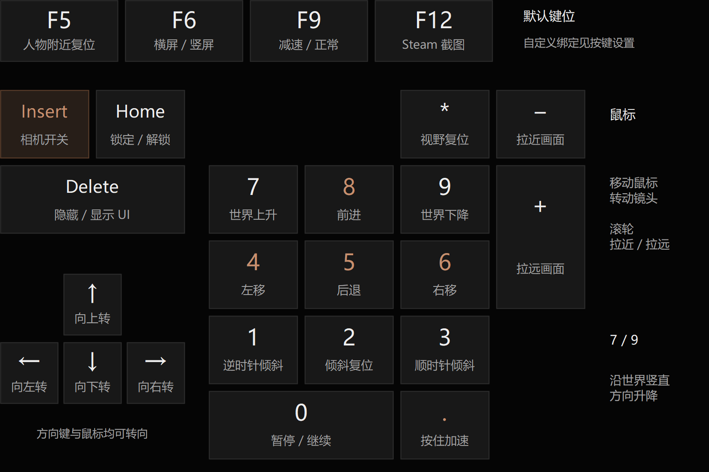

# Dark Souls III Camera · 黑暗之魂Ⅲ摄影工具

魂3自由相机工具，支持中文界面和游戏内快捷键。

作者：[Sylva-06](https://github.com/Sylva-06) · [MIT License](LICENSE) · [第三方声明与致谢](THIRD-PARTY-NOTICES.md)

## 功能

- 自由镜头、倾斜、视野调节、锁定与人物附近复位。
- 正反90°竖屏取景。
- 隐藏界面、暂停与战斗减速。
- 自定义按键、速度与鼠标手感。

## 下载与使用

从 [Releases](https://github.com/Sylva-06/DarkSoulsIIICamera/releases/latest) 下载 Windows x64 运行包，完整解压。

1. 启动游戏或模组，进入可操作场景。
2. 运行 `DS3CameraClient.exe`，点击“注入相机”。
3. 回到游戏，按 **Insert** 开启相机。

适用 **Windows x64 / Dark Souls III 1.15.2.0**，需 .NET Framework 4.x，仅离线使用。

## 默认按键

按键可在程序的“按键设置”中修改。

查看文字按键表

| 按键 | 功能 |
| --- | --- |
| Insert / Home | 相机开关 / 锁定 |
| F5 / F6 | 回到人物附近 / 横屏与正反90°竖屏 |
| Delete / 小键盘0 | 隐藏或显示UI / 暂停或继续 |
| F9 | 减速与正常时间切换，默认0.25倍 |
| 小键盘8、5、4、6 | 前、后、左、右 |
| 小键盘7、9 | 世界竖直上升、下降 |
| 小键盘1、3、2 | 左右倾斜、倾斜复位 |
| 小键盘−、+、* | 拉近、拉远、视野复位 |
| 按住小键盘 . | 仅相机平移加速，默认5倍 |
| 鼠标／方向键／滚轮 | 转向／转向／调整视野 |
| F12 | 保留给Steam截图 |

## 注意事项

- 已通过 Mod Engine 2 实测；其他相机、UI或时间控制模组可能产生冲突。
- 竖屏拍摄后，需将图片或视频反向旋转90°。升降始终沿世界竖直方向。
- 隐藏菜单后仍可操作，使用菜单前请恢复显示。
- 存档由游戏启动配置决定，测试前请备份；更新程序前请退出游戏。

## 开发

构建方法见[BUILDING.md](BUILDING.md)。
